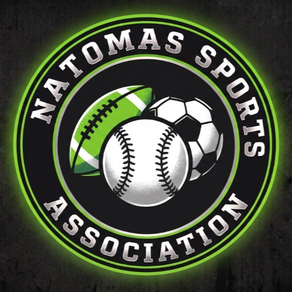

# Natomas Sports Association (NSA)

Official website repository for **Natomas Sports Association**, a youth sports organization serving Natomas and Greater Sacramento, California.



- **Domain:** [natomassportassocition.org](https://natomassportassocition.org)
- **Repository:** [github.com/mcollinswork6-tech/natomas_sports](https://github.com/mcollinswork6-tech/natomas_sports)
- **Primary Programs:** Competitive Travel Baseball (9U–14U), Multi-Sport Development (Basketball, Soccer, Speed & Agility clinics)
- **Tech Stack:** HTML5, Tailwind CSS CDN, Vanilla JavaScript, Custom SVG/Raster Vector Branding

---

## Website Architecture

| Page | File | Description |
| :--- | :--- | :--- |
| **Home Portal** | [`index.html`](index.html) | Association hero, mission, pillars of excellence, featured baseball program spotlight, and newsletter signup. |
| **Travel Baseball** | [`travel-baseball.html`](travel-baseball.html) | Flagship competitive baseball program: coaching philosophy, pitch counts, tournament schedules, and 9U–14U divisions. |
| **Sports & Programs** | [`programs.html`](programs.html) | Multi-sport roadmap: Travel Baseball, Youth Basketball, Soccer/Futsal, Athletic Clinics, and community sport voting. |
| **Tryouts & Evaluations** | [`tryouts.html`](tryouts.html) | Filterable evaluation dates by division and online player registration form. |
| **About Us** | [`about.html`](about.html) | Origin story, community commitment, coaching standards, and local business sponsorship tiers. |
| **Contact & FAQs** | [`contact.html`](contact.html) | General inquiries, field venue information (North Natomas Regional Park), and FAQ accordion. |

---

## Local Development & Preview

No build step, Node.js, or package installation is required.

To run locally on macOS or Linux:

```bash
# Navigate to the project directory
cd "/Users/matthewcollins/Documents/Natomas Sports"

# Start the local Python server
python3 -m http.server 8080
```

Open your browser to:
**[http://localhost:8080](http://localhost:8080)**

---

## Deployment & Hosting

### GitHub Pages (Recommended)
This repository is pre-configured for GitHub Pages:
1. In this repository, navigate to **Settings** > **Pages**.
2. Under **Build and deployment** > **Source**, choose **Deploy from a branch**.
3. Select **`main`** branch and root **`/ (root)`** folder, then click **Save**.
4. In the **Custom domain** section, enter: `natomassportassocition.org`.
5. Ensure **Enforce HTTPS** is checked.

### GoDaddy DNS Configuration
To link your GoDaddy domain (`natomassportassocition.org`) to GitHub Pages:
* **A Records** (Name: `@`):
  * `185.199.108.153`
  * `185.199.109.153`
  * `185.199.110.153`
  * `185.199.111.153`
* **CNAME Record** (Name: `www`):
  * `mcollinswork6-tech.github.io`

See [DEPLOYMENT_GUIDE.md](DEPLOYMENT_GUIDE.md) for full instructions.

---

## Project Structure

```
natomas_sports/
├── assets/
│   ├── css/
│   │   └── style.css            # Custom athletic styling, neon gradients & animations
│   ├── images/
│   │   ├── logo.jpg             # Official Organization Multi-Sport Crest
│   │   ├── logo-baseball.jpg    # Flagship Travel Baseball Program Emblem
│   │   ├── logo-rabbit.jpg      # Alternate Team Mascot Emblem
│   │   └── logo-horizontal.svg  # Navbar SVG Logo
│   └── js/
│       └── main.js              # Mobile navigation, division filters, and form handlers
├── index.html                   # Association Homepage
├── travel-baseball.html         # Travel Baseball Program Page
├── programs.html                # Multi-Sport Development Page
├── tryouts.html                 # Player Evaluation Registration
├── about.html                   # Mission & Sponsorships
├── contact.html                 # Contact & FAQs
├── CNAME                        # Custom domain pointer for GitHub Pages
├── DEPLOYMENT_GUIDE.md          # Step-by-step DNS and hosting guide
└── README.md                    # Project documentation
```

---

## License
&copy; 2026 Natomas Sports Association. All rights reserved.
